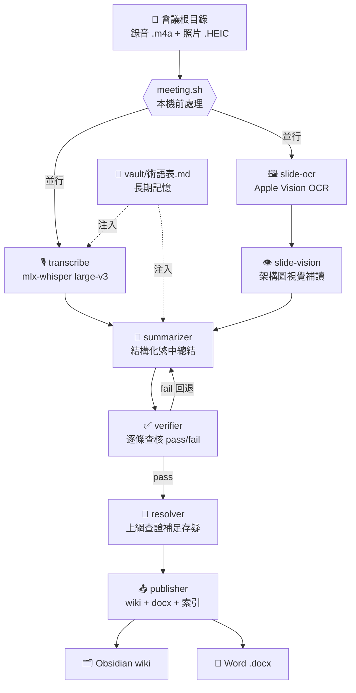

# meeting-harness — 會議總結 Agent Team（可沿用）

把一場會議/研討會/課程的**錄音 + 投影片照片**，一鍵變成：乾淨繁中逐字稿 → 投影片文字 → 結構化總結 → Obsidian wiki 頁 → Word（.docx）。獨立自包含、指向任一會議目錄即可執行，未來每場沿用。

## 目錄
```
meeting-harness/
├─ bin/                 # 可重跑的本機工具
│  ├─ meeting.sh        # ★ 前門啟動器（doctor / prep / status / record）
│  ├─ record.sh         # 錄製會議視窗（meeting record）
│  ├─ init-vault.sh     # 從 seeds/ 建立本機 vault
│  ├─ transcribe.sh     # mlx-whisper → 逐字稿（zh 用 Breeze-ASR-25；fallback large-v3 / openai-whisper）
│  ├─ _profile.py       # 會議型態 profile（六型 → 分離參數 / 總結模板 / LLM 後端）
│  ├─ _scaffold.py      # 平坦資料夾 → 場次結構（meeting ingest）
│  ├─ _render.py        # meeting.record.json → summary.md / actions.csv / actions.ics / transcript.vtt
│  ├─ _diarize_pyannote.py + setup-diarize.sh  # 講者分離（pyannote community-1，跑 MPS）
│  ├─ _voiceprint.py    # 跨會議聲紋庫（vault/voiceprints/）
│  ├─ _lint.sh          # shell/py 語法與 CJK 字串常見坑檢查
│  ├─ ocr-slides.sh + _ocr.py   # sips HEIC→JPG + Apple Vision(ocrmac) OCR
│  ├─ to-docx.sh        # pandoc md→docx
│  ├─ publish.py        # 發佈 wiki + docx + 索引（自動移除來源標註）
│  └─ _strip_cit.py, _state.py  # 內部小工具
├─ .claude/
│  ├─ agents/           # 8 個專職 subagent
│  ├─ skills/           # 7 個 skill（已 symlink 到 ~/.claude/skills，本機任何 session 都能用）
│  └─ workflows/meeting-pipeline.js   # 確定性編排引擎（可觀測/可恢復）
├─ tools/MeetingRecorder/  # 錄製器 MeetingRecorder.app 的原始碼與 build.sh
├─ schema/              # meeting-record.v1.json（總結的正規化 schema）
├─ seeds/               # 乾淨 vault 種子（術語表 / 會議索引 範本）
├─ vault/               # Obsidian wiki + 長期記憶（不進版控）
└─ config.json
```

## 流水線



## 一次性安裝
```bash
pip install mlx-whisper ocrmac      # Apple Silicon 本機、離線（首跑 large-v3 下載約 3GB）
brew install pandoc
# find-skill 用 npx，免安裝：npx skills find <關鍵字>
bash bin/init-vault.sh              # 從 seeds/ 建立本機 vault（wiki + 長期記憶）
bash bin/meeting.sh doctor          # 檢查工具鏈
```

> 注意：`vault/`（Obsidian wiki 與長期記憶，含實際會議內容）**不進版控**（見 `.gitignore`）——屬個人/機密資料，由 `init-vault.sh` 從 `seeds/` 在本機生成。

## 每場會議的資料擺法
```
<會議根目錄>/<場次名稱>/
├─ 錄音/<場次>.m4a          # 必要（m4a/mp3/wav/mov/mp4；同場多檔會自動串接）
├─ 錄音/meeting.json        # 選配但強烈建議：會議型態 + 出席名單（見下）
├─ 錄音/轉文字.txt           # 選配：現場粗轉錄（用於術語校對）
└─ 照片/*.HEIC              # 投影片照片／截圖
```

**檔案全丟在一起還沒分場？** 一行搞定：
```bash
meeting ingest "<資料夾>"            # 依時間戳自動分場（間隔 <15 分視為同一場）
meeting ingest "<資料夾>" --split    # 一個錄影檔一場
meeting ingest "<資料夾>" --dry-run  # 先看看會怎麼分
```
會把錄影**移動**到 `<場次>/錄音/`、截圖移動到 `<場次>/照片/`（原處不再留一份，不會出現重複的影片），並產出 `meeting.json` 草稿。

**`錄音/meeting.json`**（決定分離參數、總結模板、隱私後端）：
```json
{ "type": "client",
  "attendees": [{"name": "Kevin", "org": "某客戶", "role": "PM"}],
  "expectedSpeakers": 4,
  "language": "zh",
  "llm": "claude" }
```
填了 `attendees`／`expectedSpeakers`，講者分離會鎖定人數、`speaker-id-agent` 也更容易把 `SPEAKER_01` 對到真名。

## 指令一覽（`meeting help` 隨時可查）

| 指令 | 做什麼 |
|---|---|
| `meeting <根>` | 本機前處理：轉錄＋投影片 OCR＋講者分離（可重跑、冪等） |
| `meeting <型態> <根>` | 指定會議型態後前處理；型態會記住，下次不用再指定 |
| `meeting type <型態> <根或場次>` | 只設定型態，不跑前處理 |
| `meeting ingest <平坦資料夾>` | 錄影/錄音/截圖全丟一起時，依時間戳自動分場 |
| `meeting render <場次>` | 由 `meeting.record.json` 重出 summary.md / actions.csv / .ics / transcript.vtt |
| `meeting status <根>` | 每場的流水線狀態與產物 |
| `meeting diarize <場次>` | 只對單一場次做講者分離 |
| `meeting local <根> [型態]` | 全離線：前處理＋本機 LLM 總結＋發佈 |
| `meeting summarize-local <場次>` | 只對單一場次用本機 LLM 總結 |
| `meeting doctor` | 檢查工具鏈（含 ASR 模型與 Neural Engine 狀態） |
| `meeting help` / `meeting version` | 完整說明／版本（git commit） |
| `meeting record …` | 錄下會議視窗與雙路音訊，錄製中可暫停、麥克風靜音、加標記（12 種寫法見下方〈錄製會議〉） |
| `meeting search <根> <關鍵字>` | 跨場次搜尋 summary、逐字稿與 `meeting.record.json`（大小寫不分、照字面；有結果 0、沒有 1） |
| `meeting sync [off\|reported\|calibrated]` | 看／設定收尾時系統聲音的影音延遲補償（預設 off，下一次收尾起生效） |
| `meeting reminders <場次> --list <名稱> [--dry-run]` | 把交辦寫進 macOS 提醒事項的指定清單（重跑會去重；清單開 iCloud 同步時內容會離開本機） |

**相容性**：`prep` / `notes` / `status` / `doctor` / `diarize` / `summarize-local` / `local` 的
用法與語意完全沒變，舊腳本照跑；舊標記檔 `.meeting`（＝internal）與 `.diarize` 也仍然有效。
參數錯誤一律給明確訊息與非 0 結束碼（缺參數/路徑不存在＝2、找不到場次＝3），方便被其他腳本呼叫。
`meeting record` 另外用到結束碼 4（開錄前檢查的 hard 項失敗，例如權限）與 5（錄製或收尾出錯，已落盤段落保留）。
`search`、`sync`、`reminders` 是 `meeting` 頂層的保留字：根目錄剛好叫這些名字時寫 `meeting ./search` 這種 `./` 寫法。

## 用法（兩步）
```bash
# 0) 檔案還沒分場？先自動整理（選用）
bash bin/meeting.sh ingest "<平坦資料夾>"

# 1) 本機前處理（轉錄 + 講者分離 + OCR，可重跑、冪等）
bash bin/meeting.sh "<會議根目錄>"            # 沿用該場既有型態（未設過＝seminar）
bash bin/meeting.sh client "<會議根目錄>"     # 指定型態（六型見下）

# 2) AI 步驟：在 Claude Code 執行（逐字稿精修→總結→驗證→發佈 wiki+docx）
#    /meeting-summary "<會議根目錄>"

# 看狀態
bash bin/meeting.sh status "<會議根目錄>"

# 改了 meeting.record.json 想重出 summary/docx 附件
bash bin/meeting.sh render "<場次目錄>"
```

## 錄製會議（`meeting record`）

會議開始前用：錄製器 `MeetingRecorder.app` 只錄你選的那一個會議視窗，同時錄系統聲音（遠端）與麥克風（自己）；
系統聲音只錄會議視窗所屬的那個 app（錄 Chrome 裡的會議時，Chrome 其他分頁的聲音也會進來，別的 app 不會），錄會議時同一個瀏覽器不要再播其他有聲音的分頁。
每 60 秒落一段，停止後收尾成 `影片/<場次名> <時間戳>.mov` 與 `錄音/<場次名> <時間戳>.wav`，接著照上面兩步做前處理與總結。
全程本機。錄製器要先建置一次：`bash tools/MeetingRecorder/build.sh`（建到 `~/Applications/MeetingRecorder.app`），`meeting doctor` 會顯示它的狀態。

開著幕前調度（Stage Manager）時，會議視窗不在目前舞台會被縮成側邊縮圖，錄到的畫面也會跟著變小；錄會議時讓會議視窗留在目前舞台上，或先關閉幕前調度（preflight 偵測到時會提醒，不會替你改設定）。

```bash
meeting record "<會議根目錄>"   # 互動：問場次名、型態、出席者、要錄的視窗，跑開錄前檢查後開錄
meeting record stop             # 停止並收尾
meeting record status           # 目前狀態；回 5 表示上次錄製異常中止
meeting record finish "<場次>"  # 中斷後把已落盤的段落收尾（可重跑）
meeting record pause            # 整段暫停（暫停的時段在成品裡剪掉）；meeting record resume 繼續
meeting record mute             # 只靜音麥克風，系統聲音照錄；meeting record unmute 取消
meeting record mark             # 加一個「標記 N」，收尾後在 錄音/markers.json
```

<!-- record-cli:begin -->
| 寫法 | 旗標 | 結束碼 |
|---|---|---|
| `meeting record [<根>]` | `--window <id>` | 0 2 3 4 5 |
| `meeting record windows` | `--json` | 0 2 4 |
| `meeting record preflight` | `--window <id>` | 0 2 3 4 |
| `meeting record stop` | — | 0 3 5 |
| `meeting record status` | — | 0 5 |
| `meeting record finish <場次>` | — | 0 2 3 5 |
| `meeting record pause` | — | 0 3 |
| `meeting record resume` | — | 0 3 |
| `meeting record mute` | — | 0 3 |
| `meeting record unmute` | — | 0 3 |
| `meeting record mark` | — | 0 3 |
| `meeting record help` | — | 0 |
<!-- record-cli:end -->

`meeting.sh` 層旗標（所有寫法都能加，`record` 之後任何位置）：`--recorder`（明確要錄製，略過 `./record` 撞名檢查）、`--yes`（宣告沒有人可問）。
目前目錄剛好有 `record` 資料夾而沒有人可問時回 2，請改寫成 `meeting record --recorder …` 或 `meeting prep ./record`。
沒有 tty 的呼叫者（例如其他 session）要帶 `--window <id>`。完整說明：`meeting record help`。
`pause`、`resume`、`mute`、`unmute`、`mark` 和 `help` 一樣是保留字，根目錄剛好叫這些名字時寫 `meeting record ./pause` 這種 `./` 寫法。

`meeting record`（錄製）和 `meeting render`（由 `meeting.record.json` 重出產物）無關，別搞混。

**錄製中控制**：暫停 ⌃⌥⌘P（暫停的時段在成品裡剪掉）、麥克風靜音 ⌃⌥⌘M（只靜音麥克風，系統聲音照錄）、加標記 ⌃⌥⌘B（收尾後在 `錄音/markers.json`，時間是扣掉暫停後的成品時間），開始錄製是 ⌃⌥⌘R；快捷鍵要 menu bar 開著才有，也可以用上面的終端機寫法或 menu bar 選單。舊版錄製器開的錄製不能暫停／靜音／標記（回 3），重建 app 後下一場才有。
menu bar 的「錄這個視窗」「存到」、偏好設定（登入時自動開啟、停止後自動跑前處理，都預設關）、完成通知的「在 Finder 顯示」，
詳見 [`.claude/skills/meeting-record/SKILL.md`](.claude/skills/meeting-record/SKILL.md) 的〈3. 錄製中：暫停、麥克風靜音、標記〉與〈8. 快捷鍵與 menu bar〉。

**R3 的錄製行為**（細節見 [`.claude/skills/meeting-record/SKILL.md`](.claude/skills/meeting-record/SKILL.md)）：

- **同一時間只能有一場錄製**：錄製器持有 `~/.meeting-harness/record.lock` 到停止擷取（R3x 起之後改在背景收尾，見下）；鎖被持有時開錄回 2、stderr 說「已有錄製在跑」，不啟動錄製器、不碰正在錄的狀態檔；錄製中跑 preflight 也回 2（「錄製中」），不跑檢查。
- **stop 只停錄製器**：送訊號前確認鎖被持有、`record.pid` 的 pid 還活著（死掉的順手清掉）、與狀態檔的 pid 相同、程序名稱是 MeetingRecorder；任一不成立回 3、不送訊號。
- **收尾鎖與逾時**：同一場次同時只能有一個收尾（另一個回 5「這個場次正在收尾」）；每個 ffmpeg／ffprobe 步驟都有逾時，錄製器跑的收尾另有總期限（逾時或在選單按「取消收尾」都回 5、段落保留，再用 finish 收）。讀不到的段落搬到 `錄音/tracks/unreadable/`，不刪。
- **捨棄這次錄製**：只在 menu bar 的「捨棄這次錄製…」，先確認、預設鍵是「繼續錄製」；確認後不收尾，把 `錄音/` 移到垃圾桶（可放回原處）。CLI 沒有捨棄的寫法，`record` 後面寫 `discard` 會被當成根目錄名稱。
- **menu bar**：選單列是錄製膠囊（8 種外觀）、選單依待機／錄製中／收尾中／需要處理整份換掉；錄製小窗（HUD）貼在螢幕邊緣、不會被螢幕分享擷取；設定改成 7 個分頁、第一次開有 5 步引導。
- **會議偵測**：會議 app 開始用麥克風時通知問你要不要錄，只提示、不自動開錄，可在設定關掉；只讀「輸入裝置是否在用」，不打開麥克風。
- **頂層指令**：`meeting search`（跨場次搜尋）、`meeting sync`（影音延遲補償 off／reported／calibrated，預設 off）、`meeting reminders`（交辦寫進提醒事項，先用 `--dry-run` 看內容；清單開了 iCloud 同步時，內容會離開本機），見上方〈指令一覽〉與 SKILL.md〈10.〉。

**R3x：背景收尾與收尾平行度**（細節見 SKILL.md〈4. 停止〉的「背景收尾」）：

- **停止後馬上能開下一場**：錄製器停止擷取、寫完段落清單後就放開開錄鎖，收尾改在背景跑；背景收尾一次只跑一場，其他的排隊。開錄時有背景收尾還在跑會多印一行 ⚠ 提醒磁碟空間（只提醒，門檻不變）。
- **`stop`**：錄製中只停、只等這一場（排在上一場後面也照等），回這一場的結果；沒有錄製、只剩背景收尾時不送任何訊號，等它們全部結束——都成功回 0，任一失敗、異常中止或等太久回 5。
- **`status`**：多印「上一場收尾中：<場次>」（排隊中加「（排隊中）」）、「上一場收尾完成／失敗」，共用狀態就是背景收尾那一場時加「背景收尾中，可以開始下一場」；上一場收尾異常中止時，錄製中回 0 加一行 ⚠，沒有錄製在跑回 5。場次資料夾已不在的略過。
- **`finish`** 成功後清掉該場次異常中止留下的背景收尾狀態（`~/.meeting-harness/finalizing/`）。
- **menu bar**：多一個「背景收尾中」階段（可以開始錄製、也可以取消收尾，取消前先確認是哪一場）；**錄製中不能取消上一場收尾**，狀態列結尾只加「（上一場收尾中）」。
- **收尾平行度 `MH_FINALIZE_JOBS`**：分析與逐段正規化同時跑幾段，預設 3、上限 3，`1`＝串行；有下一場在錄製時自動降為 2、改用 libx264 時降為 1。menu bar 啟動的收尾讀不到終端機的環境變數，要串行時對場次跑 `MH_FINALIZE_JOBS=1 meeting record finish "<場次>"`。

> **會議視窗標記**：清單裡 ★ 的列是會議視窗（Teams、Zoom 等原生 app，或作用中分頁是會議網址的 Chrome 視窗）。
> Chrome 的標記要允許 Apple Events（選用，不授權也能錄），細節、preflight 各項怎麼救、Shortcuts 快捷鍵與 menu bar 見
> [`.claude/skills/meeting-record/SKILL.md`](.claude/skills/meeting-record/SKILL.md) 的〈會議視窗標記〉與其他段。

## 範例輸出（示意，非真實會議）

**① 檢查工具鏈** — `meeting doctor`
```text
== meeting-harness doctor ==
✓ mlx-whisper
✓ ocrmac (Apple Vision)
✓ pandoc
✓ sips
✓ ffmpeg
✓ npx (find-skill: npx skills find)
```

**② 本機前處理** — `meeting "~/會議/2026-Q3-技術分享"`
```text
== 會議根目錄：~/會議/2026-Q3-技術分享 ==

── [1] 微服務可觀測性實作 ──
  ▶ 轉錄：.../錄音/微服務可觀測性實作.m4a
[transcribe] engine=mlx-whisper model=large-v3 ...
[transcribe] DONE -> .../錄音/transcript.raw.md (912 lines; max-line-repeat=6)
  ▶ 投影片 OCR：.../照片
[ocr] 24 images ready; running Apple Vision OCR
[ocr] DONE -> .../照片/.ocr

── [2] 資料管線重構 ──
  ▶ 轉錄：.../錄音/資料管線重構.m4a
[transcribe] DONE -> .../錄音/transcript.raw.md (1043 lines; max-line-repeat=8)
  ▶ 投影片 OCR：.../照片
[ocr] DONE -> .../照片/.ocr

════════════════════════════════════════════════════
✅ 本機前處理完成（2 場）。接著在 Claude Code 執行：
    /meeting-summary "~/會議/2026-Q3-技術分享"
════════════════════════════════════════════════════
```

**③ 進度** — `meeting status "~/會議/2026-Q3-技術分享"`
```text
• 微服務可觀測性實作   transcribe:done, slide-ocr:done, summarize:done, verify:pass, resolve:done, publish:done
    ✓ transcript.md
    ✓ slides.md
    ✓ summary.md
    ✓ docx: .../exports/微服務可觀測性實作.docx
• 資料管線重構        transcribe:done, slide-ocr:done, summarize:done, verify:pass, resolve:done, publish:done
    ✓ transcript.md ✓ slides.md ✓ summary.md ✓ docx
```

## 範例：產出的總結長什麼樣（骨架，示意內容）
每場 `summary.md`／wiki 頁的結構（來源標註在發佈時自動移除，只留 `（存疑）` 與 `（來源：URL）`）：
```markdown
---
type: meeting-summary
event: 2026 Q3 技術分享
session: 微服務可觀測性實作
date: 2026-07-16
tags: [可觀測性, tracing, metrics]
---

# 微服務可觀測性實作

## 1. 一句話摘要
<一句話 + 3–5 條 TL;DR>

## 2. 議程大綱        ## 3. 重點內容        ## 4. 技術細節/架構
## 5. 實作要點/Demo   ## 6. 待辦事項         ## 7. Q&A / 講者觀點
## 8. 名詞解釋（跨會議術語表累積）
## 9. 未解/存疑（resolver 已上網查證，附來源；查不到者誠實標註）
```

## 轉錄模型（zh 專用）
中文場預設用 **[Breeze-ASR-25](https://huggingface.co/MediaTek-Research/Breeze-ASR-25)**（聯發創新基地；Whisper-large-v2 針對台灣華語與中英混雜微調），MLX 版跑在 Apple Silicon GPU 上。

| | whisper-large-v3（舊） | Breeze-ASR-25（現在） |
|---|---:|---:|
| 簡體字殘留 | 23.7% | **0.6%**（且全是 `台`→`臺` 這類誤判） |
| YouTube 字幕幻覺（「請不吝點贊 訂閱…明鏡與點點欄目」） | 3 段 | **0 段** |
| 靜音段仍吐字 | 217 段 | **0 段** |
| 60 分鐘音檔轉錄耗時 | — | **2 分 14 秒**（RTF≈0.037） |

> 實測場次：`20260915/某客戶會議`（60 分鐘）。完整對照見該場 `錄音/ab/REPORT.md`。
> 首次使用會自動下載約 3GB 模型；`meeting doctor` 會顯示是否已快取。

換模型／其他語言：
```bash
export MH_ASR_MODEL="mlx-community/whisper-large-v3-mlx"   # 單次覆寫
# 或改 config.json → transcribe.models.{zh,default,fallback}
```
非 zh 場次或 Breeze 失敗會退回 large-v3，該路徑會自動跑 OpenCC `s2twp` 轉正體（需 `pip install opencc`）。

> **raw 不動**：`transcript.raw.md` 與 `transcript.segments.json` 是引擎原始輸出，流程中不做任何刪段或改寫。精修後的稿另存 `transcript.md`。雜訊／交談重疊段所有 ASR 都可能出錯，這類內容標「（聽不清）」列入存疑，而不是刪掉。

## 進階：提升轉錄準確度（選用）
轉錄預設用通用中文提示。若你知道當場的領域術語，設環境變數可降低專名誤植：
```bash
export MH_TRANSCRIBE_HINT="以下為一場關於 <你的領域/產品/技術術語…> 的繁體中文技術演講。"
```
術語表（`vault/術語表.md`）會跨會議累積，summarizer 也會用它統一專名。

## 六種會議型態
不同會議該問的問題不一樣，講者分離的參數也不一樣。指定型態：`meeting <型態> "<資料夾>"`
（型態記在該場 `錄音/meeting.json`，之後重跑不用再指定）

| 型態 | 場景 | 分離參數 | 總結重點 |
|---|---|---|---|
| `seminar` | 研討會／演講（1 對多＋Q&A） | 保守；折疊 <30 秒的零星講者 | 議程／重點／技術細節 |
| `internal` | 內部會議（多對多） | 精準模式 | 決議／交辦 |
| `client` | 客戶會議（多對多、對外） | 精準＋有名單就鎖人數 | 決議／交辦／承諾範圍 |
| `1on1` | 一對一 | 降 `mer_cos` 防過切 | 交辦導向 |
| `workshop` | 工作坊（多組討論） | 精準、不折疊 | 分組產出／共識 |
| `interview` | 訪談／面談 | 兩人假設 | 問答逐題 |

```bash
meeting client "<會議資料夾>"     # 設定型態 + 本機前處理
meeting "<會議資料夾>"            # 型態已設過就直接跑（或預設 seminar）
meeting notes "<會議資料夾>"      # ＝ internal（舊寫法，仍相容）
# 然後在 Claude Code： /meeting-summary "<會議資料夾>"
```

開會類型態的 `summary.md`：決議 → 逐議題討論 → **交辦 `| 事項 | 負責人 | 期限 | 狀態 |`** → 依賴 → 風險與未決 → 存疑。
**負責人與期限只從逐字稿抽取，抽不到標「（未指定）」，不編造。**

## 輸出格式：一份 JSON，多種產物
總結階段只產 `meeting.record.json`（schema：`schema/meeting-record.v1.json`），其餘全部由 `bin/_render.py` 渲染——改內容就改 record 再 `meeting render <場次>`，不要直接改 `summary.md`。

| 產物 | 用途 |
|---|---|
| `summary.md` | 人看的會議紀錄。固定含「一句話：」與 `## 決議 / ## 依賴 / ## 風險與未決 / ## 交辦 / ## 存疑`，下游知識庫專案 的 `/ingest-meeting` 可直接吃 |
| `meeting.record.json` | 結構化來源，任何 agent／腳本都能讀 |
| `actions.csv` | 交辦清單，貼進 Excel／任務系統 |
| `actions.ics` | iCalendar VTODO（RFC 5545），匯入行事曆／提醒事項 |
| `錄音/transcript.vtt` | WebVTT（W3C），帶 `<v 講者>`，可餵字幕／搜尋工具 |
| `exports/*.docx` | pandoc（或 officecli） |

## 總結後端：雲端 Claude / 地端混合 / 全離線
轉錄、OCR、講者分離**本來就全在本機**；只有「總結」預設走 Claude（雲端）。機密會議可改地端：
| 模式 | 總結 | resolver 查證 | 內容外流 | 指令 |
|---|---|---|---|---|
| **Claude（預設）** | Claude（品質最好） | 線上 | 總結時送 Claude | `/meeting-summary` |
| **地端混合** | **本機 Qwen** | 線上（只送存疑關鍵詞） | 逐字稿不出電腦 | `MH_LLM=local`；或 `meeting summarize-local <場次>` |
| **全離線** | 本機 Qwen | 不跑 | 完全不出電腦 | `meeting local "<會議根目錄>"` |

地端用你本機的 **ollama**（0.19+ 已是 MLX 後端），建議模型 **Qwen 3.5 35B-mlx**（繁中最佳、Apple Silicon 最佳化；`gemma4:31b` 作 fallback）：
```bash
ollama pull qwen3.5:35b-mlx     # ~21GB，一次性
bash bin/meeting.sh doctor       # 會顯示地端模型狀態
# 單場本機總結：
bash bin/meeting.sh summarize-local "<會議根目錄>/<場次>"
# 全離線一鍵（研討會/演講）：
bash bin/meeting.sh local "<會議根目錄>"
# 全離線 + 開會模式（會議紀錄＋行動項表格＋講者分離）：
bash bin/meeting.sh local "<會議根目錄>" notes
```
> 開會/機密討論要「會議紀錄＋待辦」又要完全不出電腦 → `meeting local <根> notes`（本機 Qwen 產出決議/行動項表格，並自動講者分離）。
> 品質：Qwen3.5-35B 日常近 hosted Sonnet，但長稿忠實度/講者歸屬/存疑判斷仍略遜 Claude Opus——機密/離線走地端，公開會議可續用 Claude。長逐字稿會自動 map-reduce。

## 講者識別（誰說了什麼）

分離用 **[pyannote speaker-diarization-community-1](https://huggingface.co/pyannote/speaker-diarization-community-1)**（pyannote.audio 4），
跑在 **Apple Silicon GPU（MPS）** 上——不碰 Neural Engine。華語會議基準 AISHELL-4 **DER 11.7%**，
是目前最好的開源 pipeline；逐字稿仍是 mlx-whisper 的，這裡只加講者標籤。

本機實測（M3 Max，對照報告在 `20260907/某客戶會議/錄音/ab-diarize/REPORT.md`）：

| | 50 分鐘場次 | 60 分鐘場次 |
|---|---|---|
| 耗時（MPS） | **80 秒**（RTF 0.027） | **88 秒** |
| 與舊引擎逐秒一致率 | 94.1% | 94.8% |
| 講者數 | 4（與人工確認一致） | 3（相同） |

> CPU 跑同一場 18 分鐘還沒跑完（已中止）→ 有 MPS 就一定用 MPS，`auto` 即是。

```bash
brew install uv
bash bin/setup-diarize.sh    # 建 diarize venv（pyannote + torch，約 2.5GB，venv 在專案外）
# 一次性：到 https://huggingface.co/pyannote/speaker-diarization-community-1 按 Agree and access repository
#         並確認本機有 HF token（hf auth login，或把 read token 放 ~/.meeting-harness/hf-token）
bash bin/meeting.sh doctor   # 會告訴你環境、裝置（MPS/CPU）與模型授權是否就緒
```

分離會隨 `meeting <型態> <根>` 自動跑；也可單獨補：`meeting diarize "<場次目錄>"`。
產出 `錄音/transcript.speakers.md`（`[SPEAKER_00] …`）與 `錄音/embeddings.json`（語者向量）。

- **講者數**由會議型態決定：一對一／訪談鎖 2 人；內部／客戶會議 2–8、工作坊 3–12、研討會 1–6。
  出席名單只當**上限提示**（max = 名單人數 +1），不拿去鎖死——實測硬鎖人數反而把一致率從 94.1% 打到 80.0%
  （錄音常是多段串接，名單上的人不一定都開口，也可能有名單外的人插話）。
- 講者若被切出 10 秒上下的碎片，`MH_MIN_SPEAKER_SEC`（內部/客戶 20 秒、研討會 30 秒）會把它併入最近的主要講者。
- 用 `exclusive_speaker_diarization`（已解重疊）對齊逐字稿，一段話不會被兩個人搶。
- 歸屬要有證據：逐字段與講者段**重疊 ≥30%** 或 **重疊 ≥0.6 秒**才算數，否則標 `SPEAKER_?`（不硬塞給最近的講者）。
  兩條都要的原因是 whisper 常把前後靜音併進同一段（9 秒的段實際只講 2 秒），只看比例會冤枉它。
  門檻可用 `MH_MIN_OVERLAP_RATIO` / `MH_MIN_OVERLAP_SEC` 調。
- **折疊零星插話**：`export MH_MIN_SPEAKER_SEC=30` 把總時長 <30 秒的講者併入最近主要講者。
- 裝置可覆寫：`MH_DIARIZE_DEVICE=mps|cpu|auto`。

### 認人的三層順序
1. **聲紋庫**（下一節）——比對到就直接是名字。
2. **`speaker-id-agent`**——依「被直呼／被指派發言／自我介紹／主持行為」推定。
3. 都不確定 → 維持 `SPEAKER_0x` 並列進總結的「存疑」。**寧可匿名也不掛錯名字。**

`錄音/speakers.map.json` 兩種格式都吃：
```json
{"SPEAKER_01": {"name": "Kevin", "confidence": 0.92, "evidence": "多次被直呼 Kevin 並主持議程"}}
{"SPEAKER_00": "講者", "SPEAKER_01": "提問者A"}
```
**信心 < 0.7 不改名**。

## 聲紋庫：同一批人不用每場重猜
每週開會就是那幾個人。第一次由你確認「SPEAKER_01 就是 Kevin」後建檔，之後每場自動認出來。

```bash
meeting voiceprint add "<場次目錄>" SPEAKER_01 Kevin   # 只有你確認過的才建檔
meeting voiceprint list
meeting voiceprint remove Kevin
```

- 向量直接取自 pyannote pipeline 的 `return_embeddings`，不用另外載模型；同一人多場會累積平均。
- 比對門檻：**cos ≥ 0.75 才改名**；0.60–0.75 只寫成低信心線索（不改名），< 0.60 不寫。
  每筆都附 `evidence`（cos 值與建檔來源），可追可刪。
  實測跨天辨識：用 9/7 建的聲紋比對 9/15 的錄音，本人 **cos 0.857**（自動改名），
  未建檔的另外兩位 0.42／0.56（維持匿名，沒有亂配）。
- **不自動建檔**——自動建檔等於把猜錯的名字變成長期汙染。
- 存在 `vault/voiceprints/<姓名>.json`。**聲紋屬生物特徵資料**：只存本機、不進版控（`vault/` 已在 `.gitignore`）、
  可隨時 `voiceprint remove` 刪除。

> 為什麼不用 senko（舊方案）：它在 macOS 只跑 CoreML／ANE（`device='cpu'` 會被直接忽略），
> 而 ANE 會整台進入異常狀態（`ANEProgramProcessRequestDirect() Failed`），**且 VAD 不丟例外、只回空**，
> 看起來像「這段錄音沒人聲」。改用 pyannote 走 GPU 之後這條路徑不再依賴 ANE。

## 給本機其他 Claude Code session 用

`.claude/skills/` 的 7 個 skill 已經 symlink 到 `~/.claude/skills/`，**任何工作目錄的 session 都看得到**，
內容全部用絕對路徑呼叫本 harness，不需要 cd 到這裡：

| skill | 做什麼 |
|---|---|
| `meeting-summary` | 入口：給一個會議資料夾，走完整流程（前處理 → 寫紀錄 → 渲染） |
| `meeting-transcribe` | 語音轉逐字稿（Breeze-ASR-25／模型選擇／品質警告的意義） |
| `meeting-speakers` | 講者分離＋聲紋庫（誰說了什麼、怎麼認人、門檻怎麼定） |
| `meeting-slides` | 投影片／截圖 OCR ＋ 架構圖視覺補讀 |
| `meeting-notes` | 會議紀錄怎麼寫（record schema、六種型態模板、不編造的鐵則） |
| `meeting-publish` | 發佈 Word／Obsidian wiki／術語表與會議索引 |
| `meeting-record` | 會議開始前錄下會議視窗與雙路音訊（`meeting record`；開錄、停止、救援、會議視窗標記） |

symlink 指回這個 repo，所以**改 repo 裡的 SKILL.md 就等於改全域**，不會有兩份各自漂移。
重裝／換機器：

```bash
cd ~/.claude/skills
for s in meeting-summary meeting-notes meeting-transcribe meeting-speakers meeting-slides meeting-publish meeting-record; do
  ln -sfn "$HOME/Documents/Agent/meeting-harness/.claude/skills/$s" "$s"
done
```

> `.claude/agents/` 的 8 個 subagent 仍是**專案範圍**——在這個 repo 底下開的 session 才有。
> 其他 session 照 skill 的步驟自己做即可（skill 本身就寫得夠完整，不依賴那些 agent）。

## 方便啟用：加一個全域指令 `meeting`
```bash
echo 'alias meeting="bash $HOME/Documents/Agent/meeting-harness/bin/meeting.sh"' >> ~/.zshrc
source ~/.zshrc
# 之後任何地方： meeting "<會議根目錄>"  /  meeting doctor  /  meeting status "<根>"
```

## 沿用到新會議
資料照上面擺好 → `meeting "<新根目錄>"` → 在 Claude Code `/meeting-summary "<新根目錄>"`。術語表會跨會議自動累積。

## 授權
[MIT](LICENSE)
